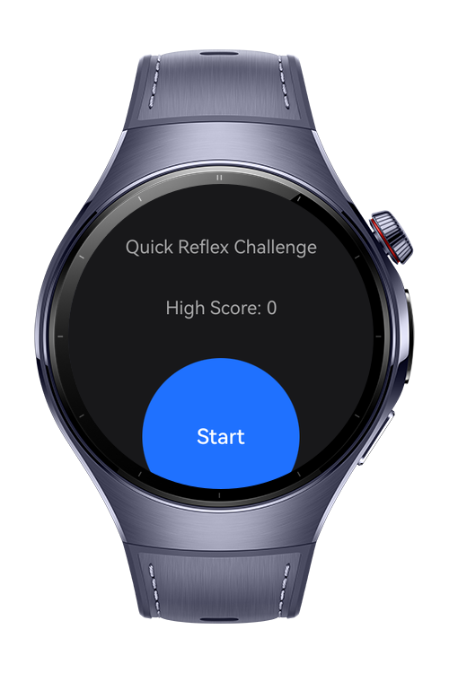
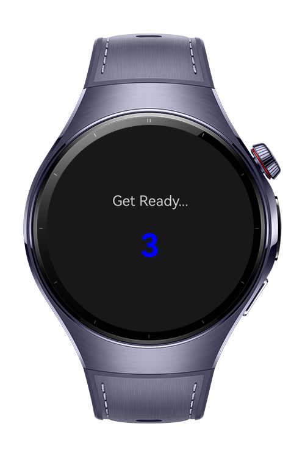
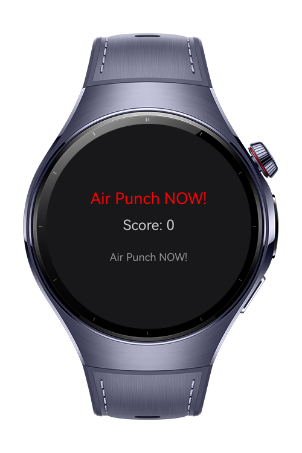
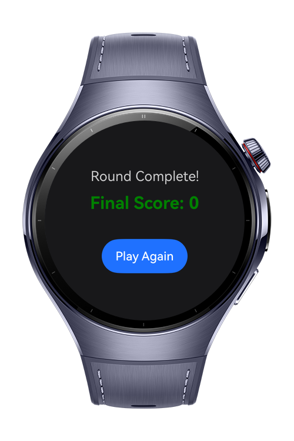

> **Note:** To access all shared projects, get information about environment setup, and view other guides, please visit [Explore-In-HMOS-Wearable Index](https://github.com/Explore-In-HMOS-Wearable/hmos-index).

# Reflex Challenge

A minimal wrist game that tests your reflexes using accelerometer and vibration timing.
The player reacts as fast as possible after the watch vibrates. Each round lasts only a few seconds.# Preview

# Preview
<div>    
  
  
  
  
</div> 

# Use Cases

User can test their reflex with the ACCELEROMETER of the watch to get points.

# Technology
## Stack
  - **Languages**: ArkTS, ARKUI
  - **Frameworks**: HarmonyOS SDK 5.1.0(18)
  - **Tools**: DevEco Studio Vers 5.1.0.842
  - **Libraries**: 
      - @kit.ArkUI 
      - @kit.AbilityKit 
      - @kit.ArkData
      - @kit.SensorServiceKit
## Required Permissions
  - `ohos.permission.ACCELEROMETER`
  - `ohos.permission.VIBRATE`

      

# Directory Structure

````
├───AppScope
│   └───resources
│       └───base
│           ├───element
│           └───media
├───entry
│   └───src
│       ├───main
│       │   ├───ets
│       │   │   ├───pages 
│       │   │   │   ├───Index
│       │   │   ├───utils
│       │   │   │   └───SoundManager
│       │   │   │   └───StorageManager
│       │   │   │   └───VibrationUtil
│       │   └───resources
│       │       ├───base
│       │       │   ├───element
│       │       │   ├───media
│       │       │   └───profile
````

# Constraints and Restrictions
## Suported Devices

- Huawei Watch 5

# LICENSE

ReflexChallenge is distributed under the terms of the MIT License.
See the [LICENSE](/LICENSE) for more information.

